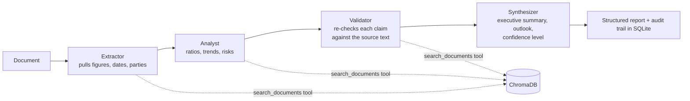

# NexusIQ

**Multi-agent document intelligence for financial and legal documents.** Upload a PDF, Word or text file, ask questions with cited sources, or run a four-agent pipeline that extracts the figures, analyses them, checks every claim against the document and writes a structured report.

Built with FastAPI, ChromaDB, OpenAI (GPT-4o with tool calling) and a Streamlit front end.

---

## What it does

| Feature | How |
|---|---|
| Document ingestion | PDF (PyMuPDF), DOCX, TXT and Markdown, split into 512-token chunks with 50-token overlap (tiktoken) |
| Search | `text-embedding-3-small` embeddings in a persistent ChromaDB collection, top-5 retrieval, optional filter by document |
| Q&A with sources | Answers cite the chunks they came from. When the retrieved text doesn't support an answer, the model says so and the answer is logged as "insufficient context" instead of being guessed |
| Streaming | `/analysis/ask/stream` streams the answer token by token |
| Four-agent analysis | Extractor → Analyst → Validator → Synthesizer (below) |
| History | Every question, analysis run and document is stored in SQLite, with a `/stats` endpoint and a dashboard page |

## The agent pipeline



Each agent is a GPT-4o call with its own system prompt. The first three can call a `search_documents` tool in up to 3 rounds per step; the Synthesizer only works from their outputs. The Validator returns `VERIFIED`, `PARTIAL` or `FAILED` with lists of verified and unverified claims, so the final report shows how much of it is actually backed by the document.

## Test run

From my local run history (no hosted demo yet, because it needs an OpenAI key):

- **Full analysis of a 27,090-word annual report** (10-K, 94 chunks): 4 agents, 16 tool calls, 9 claims verified against the source, validation status VERIFIED, report confidence HIGH.
- **10 logged questions** across three documents: 7 answered from retrieved passages, 3 answered "the documents do not contain enough information" instead of inventing a number.

---

## Run it

```bash
git clone https://github.com/dubeykrish0307/NexusIQ.git
cd NexusIQ
python -m venv venv && source venv/bin/activate
pip install -r requirements.txt
cp .env.example .env            # add your OPENAI_API_KEY

uvicorn app.main:app --reload            # API + docs on http://127.0.0.1:8000/docs
streamlit run ui/streamlit_app.py        # UI on http://localhost:8501
pytest                                   # ingestion tests
```

### API

| Method | Path | What it does |
|---|---|---|
| POST | `/documents/upload` | Parse, chunk, embed and register a document |
| GET | `/documents/list` | Documents in the store |
| DELETE | `/documents/{name}` | Remove a document and its chunks |
| POST | `/analysis/ask` | Question → answer with sources |
| POST | `/analysis/ask/stream` | Same, streamed |
| POST | `/analysis/analyze` | Run the four-agent pipeline on a document |
| GET | `/analysis/history` | Past analysis runs |
| GET | `/analysis/questions` | Past questions |
| GET | `/analysis/stats` | Totals for the dashboard |

## Project layout

```
app/
├── agents/       base agent with tool loop, extractor, analyst, validator, synthesizer, orchestrator
├── api/routes/   documents, analysis
├── core/         config, prompts, RAG engine, SQLite models
├── ingestion/    parser (pdf/docx/txt/md), token chunker
├── vectorstore/  embeddings + ChromaDB store
└── schemas/      request / response models
ui/streamlit_app.py   upload, ask, analyse and dashboard pages
```

---

## Next steps

- [ ] Evaluation set: 30 questions with known answers from public annual reports, to measure answer accuracy, citation accuracy and how often it abstains correctly.
- [ ] Conversation memory, so follow-up questions ("and the year before?") work.
- [ ] A working Dockerfile, and tests for the API routes (ingestion is covered in `tests/test_ingestion.py`).

---

**Krish Dubey**, B.Sc. Computer Science student at SRH Munich · [LinkedIn](https://www.linkedin.com/in/dubeykrish) · [GitHub](https://github.com/dubeykrish0307)
